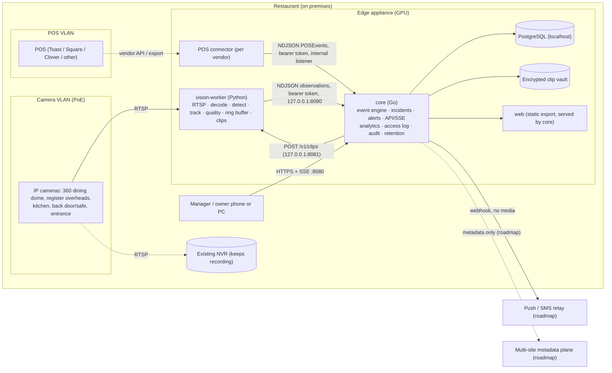
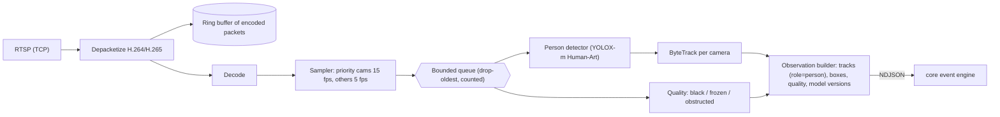
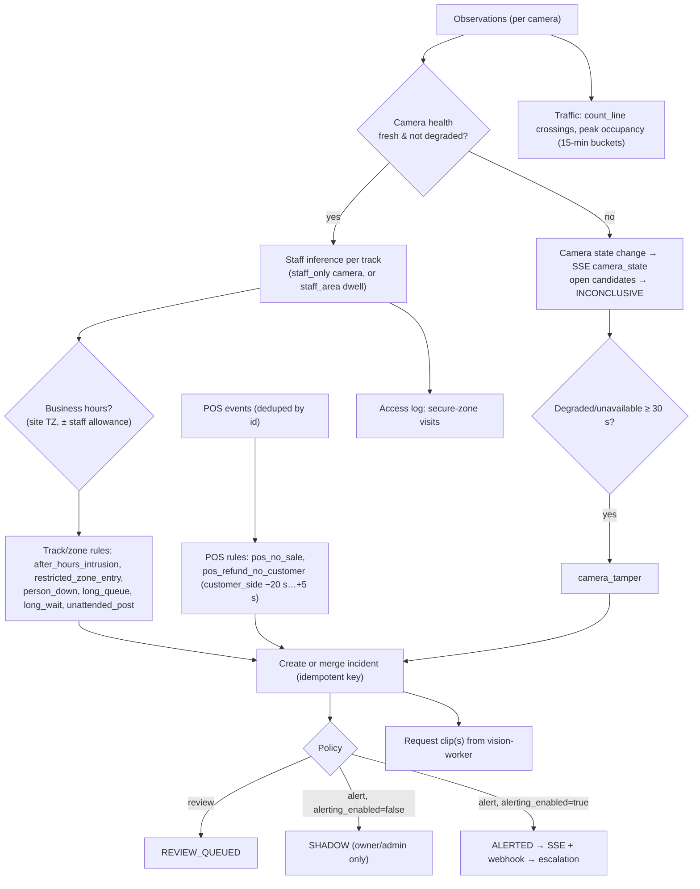

# System Architecture: Zeoatap Restaurant Watchdog

**Version:** 0.2 (restaurant) · **Date:** 2026-11-20 · **Contract:** [API.md](../packages/contracts/API.md) v2 · **Example site:** [site.example.json](../services/core/site.example.json)
Related: [ADRs](architecture/adr/) · [Diagrams](architecture/diagrams/) · [AI_MODEL_STRATEGY](AI_MODEL_STRATEGY.md) · [COST_AND_DEPLOYMENT](COST_AND_DEPLOYMENT.md)

> Status legend: **built** = implemented with automated tests on synthetic inputs · **design** = specified, not built. Nothing here has run against a real restaurant's cameras or POS.

---

## 1. Summary

- **Edge-first hybrid** ([ADR-001](architecture/adr/ADR-001-edge-first-hybrid.md)). One GPU appliance per restaurant runs everything that touches video: `vision-worker` (Python), `core` (Go), `web` (Next.js static export served by core) and PostgreSQL. **Video and clips stay on site.** A cloud plane, when built, carries metadata only.
- **Zero hardware overhaul.** The appliance reads RTSP from the restaurant's existing IP cameras (or NVR re-streams).
- **Detectors observe, rules decide, the alerter delivers, humans decide** ([ADR-002](architecture/adr/ADR-002-observation-decision-separation.md)). The worker sends anonymous person tracks (`role: "person"`); core decides staff vs. not-staff, business hours, zones, POS correlation and incidents.
- **POS events are first-class evidence** ([ADR-010](architecture/adr/ADR-010-pos-integration.md)): a connector posts NDJSON to core's internal listener.
- **Alert rules start in SHADOW** and alert only after the owner opts in per rule (`alerting_enabled`, [ADR-008](architecture/adr/ADR-008-event-level-validation-gates.md)).

---

## 2. Deployment model

| Criterion | Fully local | Cloud video analytics | **Edge + metadata cloud (chosen)** |
|---|---|---|---|
| Works when the internet drops | ✅ | ❌ | ✅ detection, local alerts, review |
| Video leaves the restaurant | No | **Yes, continuously** | No (by default) |
| Uplink needed | ~0 | N × b sustained (e.g. 12 cams × 2–4 Mbps = 24–48 Mbps [E]) | KB/s metadata + webhook payloads |
| Multi-site view | Per-site only | ✅ | ✅ once the metadata plane exists (roadmap) |
| Hardware per site | Appliance | None | Appliance |

Many SaaS vendors in the playbook (Solink, Spot AI, Coram, Verkada/Rhombus, Glimpse) offer cloud or hybrid models; see [COST_AND_DEPLOYMENT §7](COST_AND_DEPLOYMENT.md) for the comparison framing.

---

## 3. High-level architecture

| Component | Status | Why |
|---|---|---|
| vision-worker | built | GPU work in the Python model ecosystem; one pipeline per camera; restartable without losing incidents |
| core | built | Deterministic rules and all state; static Go binary; stays up when ML crashes |
| POS connector | **design** (contract built) | Vendor-specific adapter that turns POS events into `POSEvent` NDJSON. Core's endpoint and dedupe are built |
| web | built | Served by core so it works offline |
| PostgreSQL | built | One durable store; localhost only |
| Clip vault | built | AES-256-GCM per clip; served only through short-lived tokens |
| Push/SMS relay, multi-site plane | design | Webhook hook exists; relay and cloud plane do not |

---

## 4. Video pipeline (vision-worker)

- **Sampling.** `priority: true` cameras (register/POS overheads) are analysed at 15 fps, others at 5 fps. Hand-level evidence at the register needs the higher rate; occupancy and zone dwell do not.
- **No identity.** Track IDs are per camera and short-lived. The worker never classifies staff vs. customer and never computes face or body embeddings (ADR-003).
- **Clips** are cut from the encoded ring buffer (no re-encode) on request from core, written to a spool, then encrypted into the vault by core, which deletes the plaintext.
- **Backpressure.** Queue overflow drops the oldest frame and counts it; sustained drops degrade the camera's state.

---

## 5. Core event engine

| Mechanism | Behaviour | Status |
|---|---|---|
| **Health rules** | Stale observations (> 3 s) → CAMERA_UNAVAILABLE; worker reports AI unavailable → AI_UNAVAILABLE; quality flags → VIDEO_DEGRADED. ≥ 30 s non-operational → `camera_tamper` | built |
| **Staff-role inference** | A track is `staff` if seen on a `staff_only` camera (kitchen, back of house) or after dwelling in a `staff_area` zone (e.g. behind the counter). Otherwise `person`. Never from appearance or face | built (heuristic, see [AI_MODEL_STRATEGY §4](AI_MODEL_STRATEGY.md)) |
| **Business-hours schedule** | Weekly open intervals in the site's IANA timezone; `staff_before_open` / `staff_after_close` extend the staff window (Harbor Grill: 90 min each). `long_queue` and `unattended_post` apply during business hours; `after_hours_intrusion` applies outside the staff window | built |
| **Track/zone rules** | Thresholds in [AI_MODEL_STRATEGY §3](AI_MODEL_STRATEGY.md) | built |
| **POS rules** | `pos_no_sale` per `no_sale` event; `pos_refund_no_customer` when `void`/`refund`/`comp` has no person in the register's `customer_side` zone from 20 s before to 5 s after | built |
| **Traffic counting** | A track crossing a `count_line` (two-point polyline) → entry or exit by direction; per-camera peak simultaneous people; 15-min buckets | built |
| **Access log** | One row per tracked visit to a `secure` zone (safe, cooler, back door): camera, zone, role, start/end, `after_hours` | built |
| **Dedup/merge** | Same room-zone + event type + overlapping window → one incident, extra cameras add clips (§7) | built |
| **Alerting** | SSE `alert` to dashboards; webhook with retries; escalation level rises when not acknowledged within the ack timeout (default 60 s, max level 2) | built |

---

## 6. Data model (PostgreSQL)

| Table | Holds | Retention |
|---|---|---|
| `facilities`, `rooms`, `cameras` | Site config; camera authorization record (`authorized_by`, `authorized_at`, `authorization_scope`), `priority`, `staff_only`, zones | Life of site |
| `camera_states` | State transitions | 1 year [E, configurable] |
| `users`, `sessions` | Accounts (bcrypt), sessions (15 min idle) | Until removed |
| `incidents`, `incident_actions` | Incident, lifecycle, disposition, `pos_ref`, `retention_deadline`, `legal_hold` | Metadata 1 year [E]; held → until released |
| `alerts` | Per-channel delivery attempts, escalation | With incident |
| `evidence_clips` | Clip metadata (sha256, size, partial, `deleted_at`); media in vault | 30–90 days configurable; legal hold exempt |
| `pos_events` | POSEvent rows (unique on `id`): register, type, ts, amount, ticket_ref, employee_ref. **No card data** | Configurable [E: match clip retention] |
| `zone_access` | Secure-zone visits (access log) | Configurable [E: 90 days] |
| `traffic_counts` | 15-min buckets per camera: entries, exits, peak occupancy. **Aggregates only, no tracks** | 2 years [E] (no personal data) |
| `audit_log` | Hash-chained entries | Per counsel [E: 3 years] |

Pose keypoints, tracks and frames are **not persisted** outside clips.

---

## 7. Multi-camera merge

Cross-camera association uses **room zones and time, never identity**. Cameras whose zones map to the same `room_zone` (e.g. the dining 360 and a register overhead both seeing `register-1-front`) produce one incident with several clips when the event type and window overlap. POS incidents key on the register's `room_zone`. There is no cross-camera re-identification (ADR-003), so "the same person on two cameras" is never asserted. See [diagram 04](architecture/diagrams/04-multi-camera.md).

---

## 8. Failure handling and degraded states

States (worst first): `CAMERA_UNAVAILABLE` > `NOT_CONNECTED` > `AI_UNAVAILABLE` > `VIDEO_DEGRADED` > `FULLY_OPERATIONAL`. Room = worst camera; site = worst room. **Only FULLY_OPERATIONAL is green.**

| Failure | Detection | Response | Shown to staff |
|---|---|---|---|
| Camera unplugged / RTSP down | No observation > 3 s | Worker reconnects with backoff; `camera_tamper` after 30 s | Camera red "not monitored" |
| Lens covered / camera turned / frozen | Quality checks | VIDEO_DEGRADED → `camera_tamper` after 30 s | Amber + incident |
| vision-worker or GPU down | No observations / `ai_available=false` | systemd restart | AI_UNAVAILABLE |
| Observation backlog | Engine queue full | `503` with `line`; sender resends from `line` | `services.engine` |
| POS connector down or POS clock skew | No POS events during open hours [design]; skew check [design] | POS rules silent — **a missing POS feed means no POS incidents, not "all clear"** | Roadmap: POS feed health tile |
| Database down | `/readyz` 503 | Core retries | `services.database: error` |
| Clip vault/audit write fails | Write error | Clip media `503`; `clip_failed` SSE | `services.evidence: error` |
| Webhook relay failing | HTTP errors/timeouts | Retries (max attempts), `alert_delivery_failed` (short error class, never the URL) | `alerts_health.failed/delayed` |
| Internet down | — | Local SSE alerts continue; webhook retries | alerts_health |

---

## 9. Network and security boundaries

| Segment | Contains | Allowed flows | Blocked |
|---|---|---|---|
| **Camera VLAN** (PoE) | Cameras, NVR | Edge → camera RTSP (554); NVR ↔ cameras | Cameras → internet; guest Wi-Fi → cameras; staff devices → cameras |
| **POS VLAN** | POS terminals / back-office | Connector → POS vendor API or local export (vendor-specific) | Cameras ↔ POS; guest Wi-Fi ↔ POS |
| **Edge appliance** | worker, core, Postgres, vault | Core internal listener `127.0.0.1:8090` (bearer token) for worker and connector; Postgres localhost only; staff API `:8080` | Any inbound from internet; internal listener off-host |
| **Staff LAN** (not guest Wi-Fi) | Manager phones/PCs | HTTPS to core `:8080` (TLS termination guidance pending, see PRIVACY) | Direct camera or DB access |
| **Guest Wi-Fi** | Customers | Internet only | Everything on-site |
| **Internet** | Webhook relay, future metadata plane | Outbound only from edge | Inbound |

The POS connector reaches **only** core's internal listener. If the connector runs on the appliance (preferred), it posts to `127.0.0.1:8090`; a connector elsewhere requires a design change (the listener is loopback-only today). This follows the playbook's network advice: PoE cameras on a VLAN separate from guest Wi-Fi and POS.

---

## 10. Camera placement (from the playbook)

| Position | Purpose | Zone kinds | Notes |
|---|---|---|---|
| 1× 360° dome per open floor (counter / dining) | Traffic, queues, idle time, falls, (future) fights | `floor`, `queue`, `restricted` | **Cannot** read cash, drawer contents or bags. Fisheye distortion affects box-shape rules |
| 1× fixed overhead per POS terminal | Register exceptions (C1, C3; future C2/C4/C5) | `post`, `staff_area`, `customer_side`, `queue` | Mark `priority: true` (15 fps). Position/mask so **card numbers and PIN pads are not legible** (PCI DSS) |
| 1× kitchen wide | Cooler access, falls, (future) fire/PPE | `secure`, `floor` | `staff_only: true` |
| 1× pass / expo | Future A8/D2 | — | Roadmap |
| 1× back door / dock | D1 access log, after-hours | `secure` | `staff_only: true` |
| 1× walk-in cooler door | D5 | `secure` | |
| 1× time clock | Future B1–B3 | — | No face matching |
| 1× safe | G4 | `secure` | |
| 1× entrance | People counting (A1/A2) | `count_line` | Top-down or high oblique for clean line crossings |
| **Never** | Restrooms, changing rooms, locker areas, break rooms | — | Policy, not configuration |

---

## 11. Deployment topologies and scaling

| Stage | Cameras | Topology | Notes |
|---|---|---|---|
| Lab | 1–5 (file replay / synthetic RTSP) | Workstation | Built today |
| Single restaurant | 6–16 | 1 appliance, 1 GPU | Capacity per [BENCHMARK_RESULTS](BENCHMARK_RESULTS.md); inference-only bound ≈ 46 cams/GPU with TensorRT FP16 (not used by the worker yet) |
| Multi-site group | N sites × 6–16 | 1 appliance per site + metadata plane | Roadmap: one dashboard across sites (playbook "tune & expand") |

**Why not Kubernetes/Redis/a broker:** one box per site; each extra stateful service is more to secure. NATS is reconsidered only with multiple GPU nodes per site ([ADR-006](architecture/adr/ADR-006-service-boundaries.md)).

---

## 12. Service boundaries (as built)

| Interface | Transport | Auth |
|---|---|---|
| vision → core `POST /internal/v1/observations` | NDJSON over HTTP, loopback | `Authorization: Bearer $ZEOATAP_INTERNAL_TOKEN` |
| POS connector → core `POST /internal/v1/pos-events` | NDJSON over HTTP, internal listener | Same token |
| core → vision `POST /v1/clips` | JSON over HTTP, loopback `:8081` | Same token |
| browser → core `/api/v1/*` | JSON + SSE | Session cookie, roles |

gRPC was the original plan and was dropped ([ADR-006](architecture/adr/ADR-006-service-boundaries.md), amended).

---

## 13. ADR index

| ADR | Decision | Status |
|---|---|---|
| [001](architecture/adr/ADR-001-edge-first-hybrid.md) | Edge-first hybrid | Accepted |
| [002](architecture/adr/ADR-002-observation-decision-separation.md) | Detectors observe, rules decide, alerter delivers, humans decide | Accepted |
| [003](architecture/adr/ADR-003-no-biometric-identity.md) | No face recognition / biometric identity | Accepted (strengthened) |
| [004](architecture/adr/ADR-004-licensing-safe-model-stack.md) | Licensing-safe model stack | Accepted (FiDIP etc. removed) |
| [005](architecture/adr/ADR-005-video-pipeline.md) | PyAV + ONNX Runtime/TensorRT first; DeepStream only if benchmark justifies | Proposed |
| [006](architecture/adr/ADR-006-service-boundaries.md) | Three processes + Postgres; NDJSON/HTTP | Accepted (amended) |
| [007](architecture/adr/ADR-007-vlm-off-critical-path.md) | VLM off the critical path; search later | Accepted |
| [008](architecture/adr/ADR-008-event-level-validation-gates.md) | Alerting opt-in per rule after shadow tuning | Accepted (rewritten) |
| [009](architecture/adr/ADR-009-restaurant-pivot.md) | Pivot to restaurant loss prevention, safety and ops | Accepted |
| [010](architecture/adr/ADR-010-pos-integration.md) | POS events as first-class evidence | Accepted |
