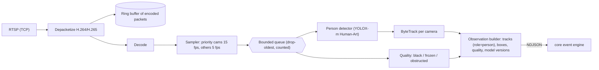

# 02-video-pipeline

Source of truth: SYSTEM_ARCHITECTURE.md §4 (kept in sync).

`priority` cameras (register/POS overheads) are sampled at 15 fps, others at 5 fps. The worker never labels staff vs. customer and computes no face or body embeddings.
