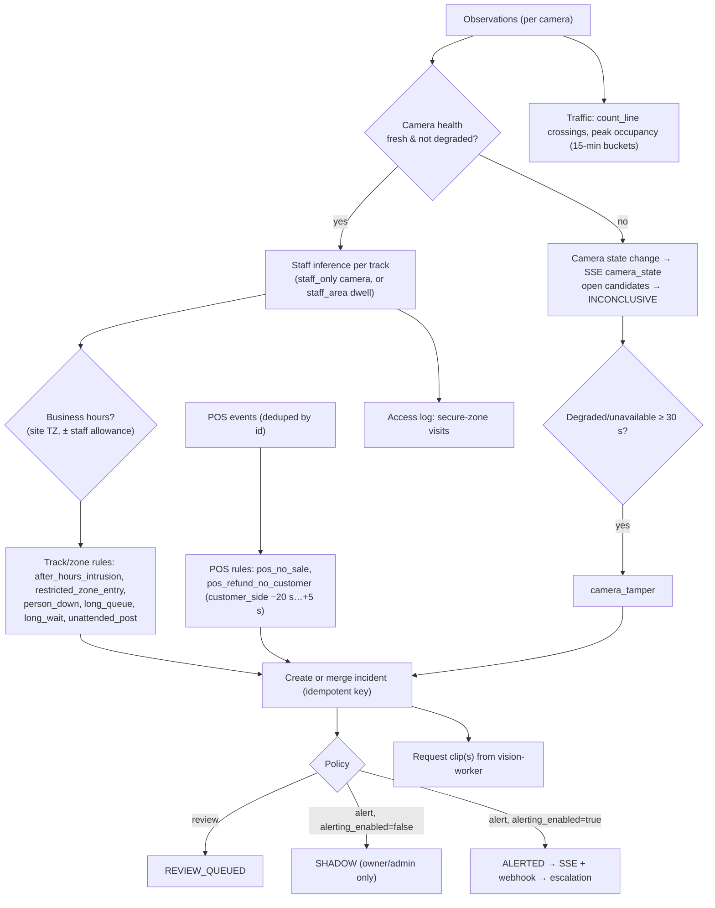

# 03-incident-decision-flow

Source of truth: SYSTEM_ARCHITECTURE.md §5 (kept in sync).

POS path: a POS event for a known register (deduped by `id`) is evaluated by the POS rules against the register camera's `customer_side` zone; it shares incident creation, policy and clip capture with the video rules.
