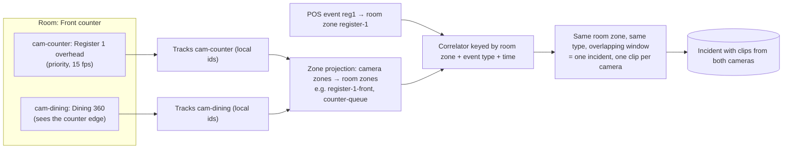

# 04-multi-camera

Source of truth: SYSTEM_ARCHITECTURE.md §7 (kept in sync).

No identity is carried between cameras: no face, no appearance embedding (ADR-003). Two tracks are never asserted to be the same person.
