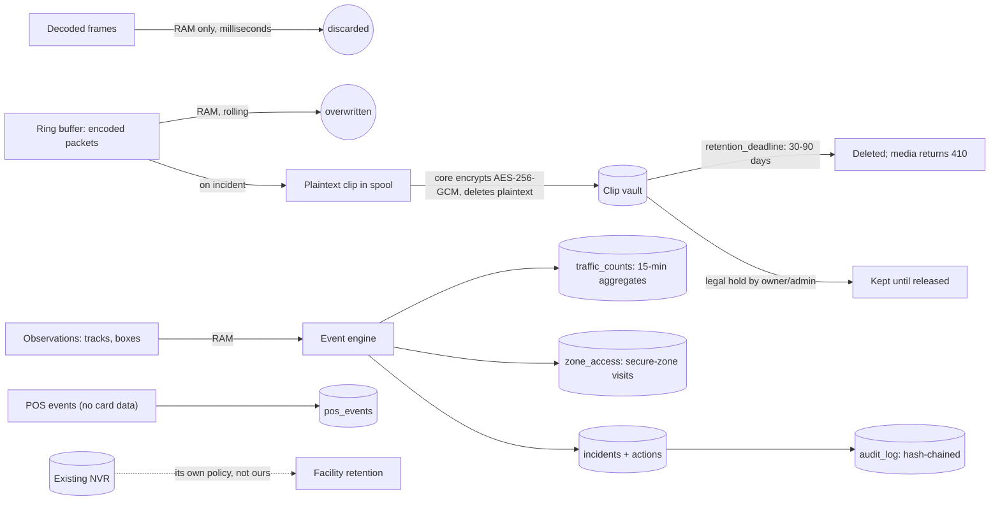

# 05-data-retention-lifecycle

Source of truth: SYSTEM_ARCHITECTURE.md §6 and PRIVACY_SECURITY_COMPLIANCE.md §5 (kept in sync).

Never stored: audio, face or body embeddings, biometric templates, card numbers or PINs.
