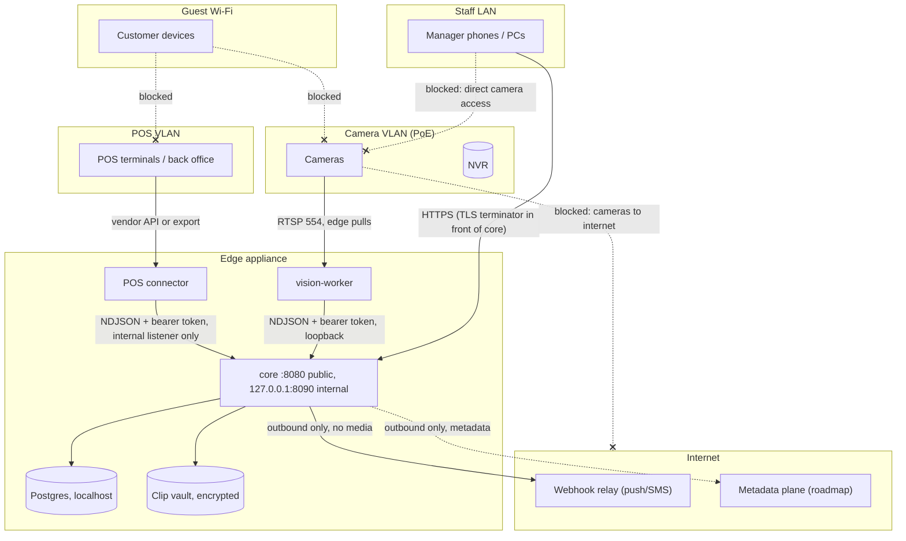

# 06-network-security-boundaries

Source of truth: SYSTEM_ARCHITECTURE.md §9 (kept in sync).

Cameras, POS and guest Wi-Fi are three separate segments (playbook network advice). The POS connector reaches only core's internal listener.
