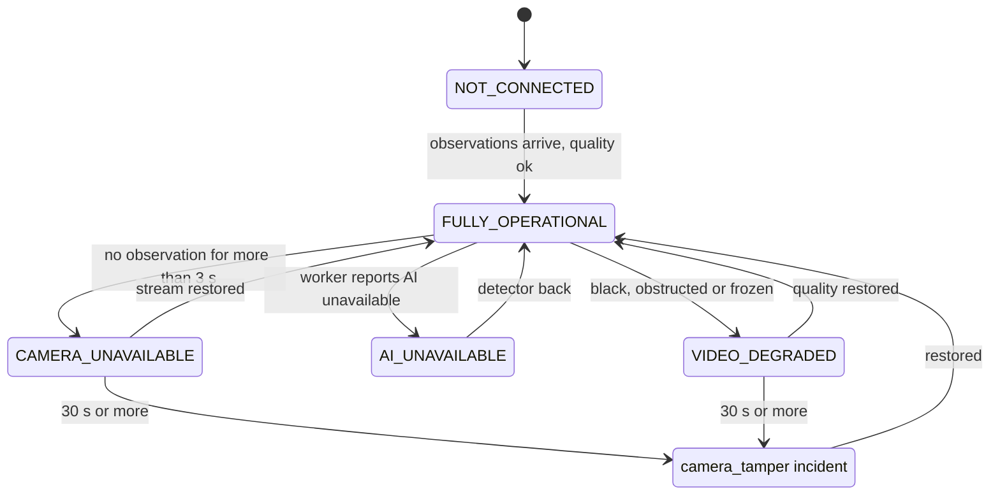

# 07-failure-degraded-states

Source of truth: SYSTEM_ARCHITECTURE.md §8 and API.md "Monitoring states" (kept in sync).

Severity order (worst first): CAMERA_UNAVAILABLE > NOT_CONNECTED > AI_UNAVAILABLE > VIDEO_DEGRADED > FULLY_OPERATIONAL. Room = worst camera, site = worst room; only FULLY_OPERATIONAL is green. Open candidates on a camera that leaves FULLY_OPERATIONAL end INCONCLUSIVE. Service-level problems (database, engine, evidence, webhook delivery, silent POS feed) are shown separately in the overview's `services` and `alerts_health`.
