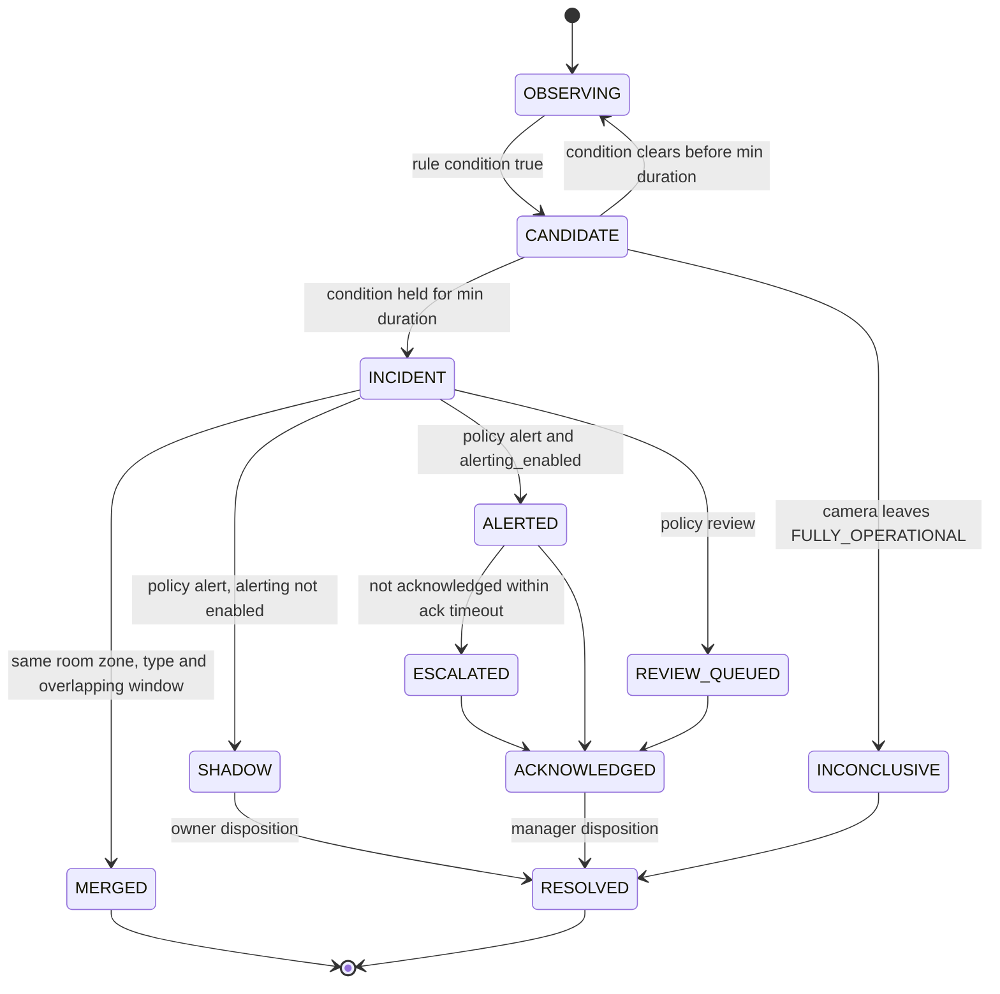

# 09-decision-engine-states

Source of truth: AI_MODEL_STRATEGY.md §7 and API.md (kept in sync).

POS rules enter at INCIDENT directly when the POS event's window has been evaluated. Dispositions: `ok`, `coach`, `investigate`, `false_detection`, `escalated_external`, `inconclusive`. Incident `status` values in the API are ALERTED, REVIEW_QUEUED, SHADOW and INCONCLUSIVE; `lifecycle` is new → acknowledged → resolved.
